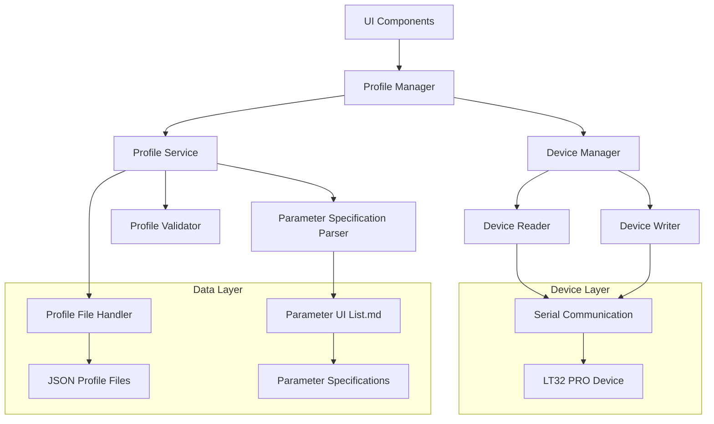

# Design Document

## Overview

The LT32 PRO Universal Profile System is designed to provide a robust, maintainable solution for loading and saving device configurations between the UI and physical devices. The system leverages the Parameter UI List specification as the single source of truth, ensuring consistency and eliminating compatibility issues with previous implementations.

The design follows a layered architecture that separates concerns between UI interaction, profile management, device communication, and data persistence. This approach ensures maintainability, testability, and extensibility for future parameter additions.

## Architecture

### High-Level Architecture



### Component Responsibilities

1. **Profile Manager**: Orchestrates all profile operations and provides the main API
2. **Profile Service**: Handles profile file operations and validation
3. **Device Manager**: Manages device communication for reading/writing parameters
4. **Parameter Specification Parser**: Parses the Parameter UI List to extract specifications
5. **Profile Validator**: Validates profile data against specifications
6. **Profile File Handler**: Manages JSON profile file I/O operations

## Components and Interfaces

### 1. Universal Profile Manager

The main orchestrator that provides a unified interface for all profile operations.

```python
class UniversalProfileManager:
    def __init__(self, serial_service, parameter_ui_list_path: str)
    
    # Core operations
    async def load_from_device(self, progress_callback: Optional[Callable] = None) -> ProfileOperationResult
    async def save_to_device(self, progress_callback: Optional[Callable] = None) -> ProfileOperationResult
    async def load_from_file(self, file_path: str) -> ProfileOperationResult
    async def save_to_file(self, file_path: str, profile_name: str) -> ProfileOperationResult
    
    # UI integration
    def get_current_profile(self) -> UniversalProfile
    def set_current_profile(self, profile: UniversalProfile) -> None
    def populate_ui_fields(self, ui_field_values: Dict[str, Any]) -> None
    def extract_ui_field_values(self) -> Dict[str, Any]
```

### 2. Parameter Specification Parser

Parses the Parameter UI List markdown file to extract parameter specifications.

```python
class ParameterSpecificationParser:
    def __init__(self, parameter_ui_list_path: str)
    
    def parse_specifications(self) -> Dict[str, ParameterSpec]
    def get_parameter_spec(self, parameter_name: str) -> Optional[ParameterSpec]
    def get_all_parameters(self) -> List[str]
    def get_parameters_by_section(self, section: str) -> List[ParameterSpec]
    def validate_parameter_value(self, param_name: str, value: Any) -> ValidationResult
```

### 3. Universal Profile Service

Handles profile file operations and validation using the parameter specifications.

```python
class UniversalProfileService:
    def __init__(self, spec_parser: ParameterSpecificationParser)
    
    def create_profile_from_ui(self, ui_values: Dict[str, Any], profile_name: str) -> UniversalProfile
    def create_profile_from_device(self, device_responses: Dict[str, str], profile_name: str) -> UniversalProfile
    def save_profile_to_file(self, profile: UniversalProfile, file_path: str) -> bool
    def load_profile_from_file(self, file_path: str) -> UniversalProfile
    def validate_profile(self, profile: UniversalProfile) -> ValidationResult
    def migrate_profile(self, profile: UniversalProfile) -> UniversalProfile
```

### 4. Device Communication Manager

Manages device reading and writing operations using existing services.

```python
class DeviceCommunicationManager:
    def __init__(self, serial_service, spec_parser: ParameterSpecificationParser)
    
    async def read_all_parameters(self, progress_callback: Optional[Callable] = None) -> Dict[str, str]
    async def write_all_parameters(self, parameters: Dict[str, str], progress_callback: Optional[Callable] = None) -> Dict[str, bool]
    def parse_device_response(self, command: str, response: str) -> Optional[Dict[str, Any]]
    def format_parameter_for_device(self, param_spec: ParameterSpec, value: Any) -> Optional[str]
```

## Data Models

### 1. Universal Profile

The main data structure representing a complete device configuration.

```python
@dataclass
class UniversalProfile:
    name: str
    version: str
    created_at: datetime
    modified_at: datetime
    metadata: ProfileMetadata
    parameters: Dict[str, ParameterValue]
    
    def to_dict(self) -> Dict[str, Any]
    def from_dict(cls, data: Dict[str, Any]) -> 'UniversalProfile'
    def get_parameter_value(self, param_name: str) -> Optional[Any]
    def set_parameter_value(self, param_name: str, value: Any) -> None
    def validate(self, spec_parser: ParameterSpecificationParser) -> ValidationResult
```

### 2. Parameter Specification

Represents a parameter definition from the Parameter UI List.

```python
@dataclass
class ParameterSpec:
    name: str
    label: str
    section: str
    ui_element: str
    validation: Optional[str]
    unit: Optional[str]
    options: Optional[List[str]]
    visibility_condition: Optional[str]
    commands: ParameterCommands
    fields: Optional[List[ParameterField]]  # For complex parameters
    
    def validate_value(self, value: Any) -> ValidationResult
    def get_default_value(self) -> Any
    def is_visible(self, context: Dict[str, Any]) -> bool
```

### 3. Parameter Commands

Represents the device commands associated with a parameter.

```python
@dataclass
class ParameterCommands:
    set_command: Optional[str]
    read_command: Optional[str]
    command_format: Optional[str]
    
    def format_set_command(self, value: Any) -> str
    def parse_read_response(self, response: str) -> Optional[Any]
```

### 4. Profile Operation Result

Represents the result of any profile operation.

```python
@dataclass
class ProfileOperationResult:
    operation_type: str
    success: bool
    profile: Optional[UniversalProfile]
    parameters_processed: int
    parameters_successful: int
    parameters_failed: int
    duration_seconds: float
    errors: List[str]
    warnings: List[str]
    details: Dict[str, Any]
```

## Error Handling

### Error Categories

1. **Connection Errors**: Device not connected or communication failures
2. **Validation Errors**: Invalid parameter values or profile structure
3. **File Errors**: Profile file read/write issues
4. **Parsing Errors**: Parameter UI List parsing failures
5. **Device Errors**: Device-specific error responses

### Error Handling Strategy

```python
class ProfileErrorHandler:
    def handle_device_communication_error(self, error: Exception, context: str) -> ErrorHandlingResult
    def handle_validation_error(self, validation_result: ValidationResult) -> ErrorHandlingResult
    def handle_file_operation_error(self, error: Exception, file_path: str) -> ErrorHandlingResult
    def handle_parsing_error(self, error: Exception, source: str) -> ErrorHandlingResult
    
    def create_user_friendly_message(self, error: Exception) -> str
    def suggest_resolution_steps(self, error: Exception) -> List[str]
    def should_retry_operation(self, error: Exception) -> bool
```

### Recovery Mechanisms

1. **Partial Success Handling**: Continue processing other parameters when some fail
2. **Retry Logic**: Automatic retry for transient communication errors
3. **Fallback Values**: Use default values when parameter loading fails
4. **Profile Migration**: Handle profile format changes gracefully
5. **User Guidance**: Provide clear error messages and resolution steps

## Testing Strategy

### Unit Testing

1. **Parameter Specification Parser Tests**
   - Test parsing of Parameter UI List markdown
   - Validate parameter specification extraction
   - Test error handling for malformed specifications

2. **Profile Service Tests**
   - Test profile creation from UI values
   - Test profile creation from device responses
   - Test profile validation logic
   - Test file I/O operations

3. **Device Communication Tests**
   - Mock device communication for testing
   - Test command formatting and response parsing
   - Test error handling and retry logic

### Integration Testing

1. **End-to-End Profile Operations**
   - Test complete load from device workflow
   - Test complete save to device workflow
   - Test profile file save/load workflow

2. **UI Integration Tests**
   - Test UI field population from profiles
   - Test profile creation from UI values
   - Test parameter visibility conditions

3. **Device Communication Integration**
   - Test with actual device communication (when available)
   - Test error scenarios and recovery
   - Test progress reporting

### Performance Testing

1. **Large Profile Handling**
   - Test with profiles containing all parameters
   - Measure operation completion times
   - Test memory usage during operations

2. **Device Communication Performance**
   - Measure command execution times
   - Test timeout handling
   - Test concurrent operation handling

## Implementation Phases

### Phase 1: Core Infrastructure
- Implement Parameter Specification Parser
- Create Universal Profile data models
- Implement basic Profile Service
- Create comprehensive unit tests

### Phase 2: Device Integration
- Integrate with existing device reader/writer services
- Implement Device Communication Manager
- Add device response parsing logic
- Test with actual device communication

### Phase 3: File Operations
- Implement profile file I/O
- Add profile validation and migration
- Create profile format documentation
- Test file operation error handling

### Phase 4: UI Integration
- Integrate with existing UI components
- Implement UI field population/extraction
- Add progress reporting for UI
- Test complete user workflows

### Phase 5: Error Handling & Polish
- Implement comprehensive error handling
- Add user-friendly error messages
- Optimize performance
- Complete integration testing

## Migration Strategy

### From Existing Profile System

1. **Backward Compatibility**: Support loading existing profile formats during transition
2. **Data Migration**: Provide tools to convert existing profiles to universal format
3. **Gradual Rollout**: Allow both systems to coexist during migration period
4. **Validation**: Ensure migrated profiles work correctly with devices

### Parameter UI List Updates

1. **Version Tracking**: Include version information in profiles
2. **Schema Evolution**: Handle parameter additions/removals gracefully
3. **Default Values**: Provide sensible defaults for new parameters
4. **Deprecation Handling**: Support deprecated parameters during transition

This design provides a robust foundation for the universal profile system while maintaining compatibility with existing components and allowing for future extensibility.