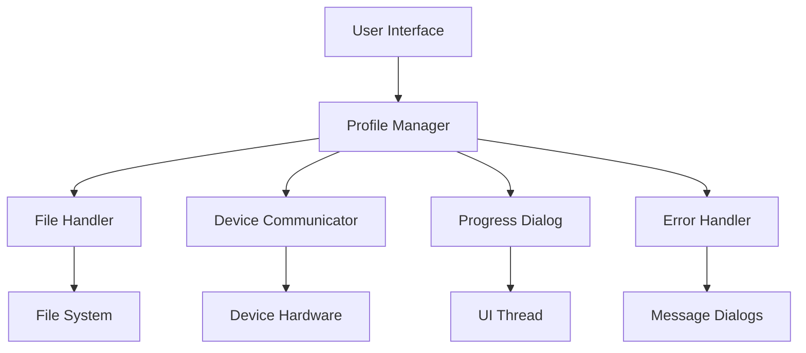

# Profile Feature Complete Revision Design Document

## Overview

This design completely revises the profile functionality to create a simple, reliable system that actually works. The focus is on fixing the core problems: broken progress tracking, non-functional profile loading to device, and poor user experience. The solution emphasizes simplicity over complexity, using proven patterns and minimal components.

## Architecture

### Simplified Architecture



### Design Principles

1. **Simplicity First**: Use the minimum number of components necessary
2. **Proven Patterns**: Leverage existing working code patterns from the application
3. **Direct Integration**: Work directly with existing device communication methods
4. **Robust Error Handling**: Handle errors gracefully without complex recovery mechanisms
5. **UI Responsiveness**: Keep the UI responsive during all operations

## Components and Interfaces

### 1. Profile Manager (Core Component)

**Purpose**: Single point of control for all profile operations

```python
class ProfileManager:
    def save_profile_from_ui(self, file_path: str) -> bool
    def save_profile_from_device(self, file_path: str) -> bool
    def load_profile_to_ui(self, file_path: str) -> bool
    def load_profile_to_device(self, file_path: str) -> bool
```

**Key Features**:
- Single class handles all profile operations
- Uses existing UI parameter access methods
- Integrates with existing device communication
- Simple boolean return values for success/failure

### 2. File Handler (Utility Component)

**Purpose**: Simple, reliable file I/O operations

```python
class FileHandler:
    def read_ini_file(self, file_path: str) -> configparser.ConfigParser
    def write_ini_file(self, file_path: str, config: configparser.ConfigParser) -> bool
    def file_exists_and_readable(self, file_path: str) -> bool
```

**Key Features**:
- Uses Python's built-in configparser for INI files
- Simple error handling with try/catch blocks
- No complex validation or conversion logic
- Direct file system operations

### 3. Progress Dialog (UI Component)

**Purpose**: Simple, reliable progress indication with language support

```python
class SimpleProgressDialog:
    def __init__(self, parent, title_key: str, total_steps: int)
    def update_progress(self, current_step: int, message_key: str, param_name: str = "")
    def close_dialog(self)
```

**Key Features**:
- Basic Tkinter dialog with progress bar
- Thread-safe updates using tkinter's after() method
- Full language support using existing translation system
- Dynamic message formatting with parameter names
- No complex animations or features that can fail
- Automatic cleanup on completion or error

### 4. Device Communicator (Integration Component)

**Purpose**: Bridge to existing device communication methods

```python
class DeviceCommunicator:
    def send_parameter_to_device(self, param_name: str, param_value: str) -> bool
    def get_parameter_from_device(self, param_name: str) -> str
    def is_device_connected(self) -> bool
```

**Key Features**:
- Wraps existing device communication methods
- Simple parameter-by-parameter transmission
- Built-in connection checking
- Direct integration with current device protocols

## Data Models

### Profile File Format (INI Structure)

```ini
[Profile_Info]
profile_name = My Configuration
created_date = 2025-01-08 10:30:00
source = UI  ; or "Device"
parameter_count = 25

[Device_Parameters]
parameter1 = value1
parameter2 = value2
; ... all device parameters
```

**Format Rules**:
- Standard INI file format using Python's configparser
- Two main sections: Profile_Info and Device_Parameters
- Profile_Info contains metadata about the profile
- Device_Parameters contains all configuration parameters
- Same format used for both UI-saved and device-saved profiles

### Parameter Mapping

```python
# Simple dictionary structure for parameters
parameters = {
    "parameter_name": "parameter_value",
    # All values stored as strings, converted as needed
}
```

**Mapping Rules**:
- All parameter values stored as strings in the file
- Type conversion handled during load/save operations
- Parameter names match exactly between UI, device, and file
- No complex data structures or nested objects

## Error Handling

### Simple Error Handling Strategy

**Principle**: Fail fast with clear messages, don't try to recover from complex errors

```python
def load_profile_to_device(self, profile_path: str) -> bool:
    try:
        # Check file exists and is readable
        if not os.path.exists(profile_path):
            self.show_error("Profile file not found")
            return False
        
        # Read the profile file
        config = configparser.ConfigParser()
        config.read(profile_path)
        
        # Check required sections exist
        if not config.has_section('Device_Parameters'):
            self.show_error("Invalid profile file: missing Device_Parameters section")
            return False
        
        # Check device connection
        if not self.device_communicator.is_device_connected():
            self.show_error("Device not connected")
            return False
        
        # Load parameters to device
        return self._send_parameters_to_device(config['Device_Parameters'])
        
    except Exception as e:
        self.show_error(f"Profile loading failed: {str(e)}")
        return False
```

### Progress Tracking Implementation

**Strategy**: Real progress based on actual work done

```python
def _send_parameters_to_device(self, parameters) -> bool:
    total_params = len(parameters)
    progress_dialog = SimpleProgressDialog(self.parent, "Loading Profile", total_params)
    
    try:
        for i, (param_name, param_value) in enumerate(parameters.items()):
            # Update progress before each parameter
            progress_dialog.update_progress(i, f"Setting {param_name}")
            
            # Send parameter to device
            success = self.device_communicator.send_parameter_to_device(param_name, param_value)
            if not success:
                progress_dialog.close_dialog()
                self.show_error(f"Failed to set parameter: {param_name}")
                return False
        
        # Final progress update
        progress_dialog.update_progress(total_params, "Complete")
        progress_dialog.close_dialog()
        return True
        
    except Exception as e:
        progress_dialog.close_dialog()
        self.show_error(f"Error during parameter transmission: {str(e)}")
        return False
```

## Testing Strategy

### Core Functionality Tests

1. **Profile File Operations**
   - Save profile from UI to file
   - Save profile from device to file
   - Load profile from file to UI
   - Load profile from file to device
   - File format consistency between all operations

2. **Progress Dialog Tests**
   - Progress dialog shows and updates correctly
   - Progress reflects actual work being done
   - Dialog closes properly on completion
   - Dialog handles errors without crashing

3. **Device Communication Tests**
   - Device connection detection
   - Parameter transmission to device
   - Error handling for device communication failures
   - Progress tracking during device operations

### Integration Tests

1. **Round-Trip Operations**
   - UI → Profile File → UI (parameter preservation)
   - Device → Profile File → Device (parameter preservation)
   - UI → Profile File → Device (cross-compatibility)
   - Device → Profile File → UI (cross-compatibility)

2. **Error Scenario Tests**
   - Missing profile files
   - Corrupted profile files
   - Device disconnection during operations
   - File permission errors

### User Experience Tests

1. **UI Responsiveness**
   - Interface remains responsive during profile operations
   - Progress dialogs don't freeze or become unresponsive
   - Error messages are clear and actionable
   - Operations can be cancelled if needed

2. **Real-World Scenarios**
   - Large profile files with many parameters
   - Profiles with special characters in values
   - Multiple profile operations in sequence
   - Profile operations with slow device communication

## Implementation Approach

### Core Implementation Strategy

1. **Start Simple**: Implement basic file I/O and parameter handling first
2. **Build Incrementally**: Add progress tracking after core functionality works
3. **Test Early**: Verify each component works before adding complexity
4. **Use Existing Code**: Leverage current device communication and UI access methods

### Key Implementation Details

#### Profile File Format
- Use Python's configparser for reliable INI file handling
- Two sections: Profile_Info (metadata) and Device_Parameters (all parameters)
- Same format for UI-saved and device-saved profiles

#### Progress Tracking
- Count total parameters before starting operation
- Update progress after each parameter is processed
- Use tkinter's after() method for thread-safe UI updates
- Close dialog automatically on completion or error

#### Device Communication
- Use existing device communication methods from the application
- Check device connection before starting operations
- Send parameters one by one with individual error checking
- Provide clear error messages for communication failures

#### Language Support
- All user-facing text must use the existing translation system
- Progress dialog titles and messages support the configured language
- Error messages and success notifications are localized
- Parameter names in progress updates are displayed in the appropriate language
- File dialog titles and filters support localization

#### UI Integration
- Integrate with existing UI parameter access methods
- Keep operations on background threads to maintain UI responsiveness
- Use simple message boxes for error reporting with full language support
- Provide clear success/failure feedback in the configured language
- Use existing translation system for all user-facing text
- Support dynamic message formatting for parameter names and values

## Success Metrics

1. **Functionality**: Profile loading to device actually works and sends parameters
2. **Progress**: Progress dialogs show accurate progress without freezing
3. **Compatibility**: Profiles saved from UI can be loaded to device and vice versa
4. **Reliability**: Operations complete successfully or fail with clear error messages
5. **User Experience**: Interface remains responsive and provides clear feedback

## Risk Mitigation

### Technical Risks
- **UI Thread Blocking**: Use background threads for all long operations
- **Device Communication Failures**: Check connection before starting, handle errors gracefully
- **File Access Issues**: Validate file permissions and existence before operations
- **Progress Dialog Crashes**: Use simple, proven UI patterns with minimal complexity

### User Experience Risks
- **Confusing Error Messages**: Use plain language error messages with specific actions in the user's configured language
- **Lost Progress**: Save progress state and provide recovery options
- **Inconsistent Behavior**: Use the same code paths for all similar operations
- **Performance Issues**: Optimize for common use cases, handle large profiles efficiently
- **Language Support**: Ensure all UI text, error messages, and progress indicators support the configured language

This design prioritizes working functionality over architectural elegance, ensuring that users get a reliable profile system that actually works.