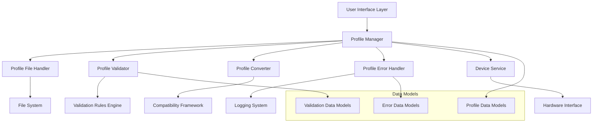

# Developer Documentation: Profile Compatibility Fix Architecture

## Overview

This document provides comprehensive technical documentation for the profile compatibility fix implementation in the LT32Pro Device Configurator. It covers the new component architecture, APIs, integration patterns, and development guidelines.

## Architecture Overview

### Component Hierarchy



### Design Principles

1. **Separation of Concerns**: Each component has a single, well-defined responsibility
2. **Dependency Injection**: Components receive dependencies through constructor injection
3. **Error Isolation**: Errors are contained and handled at appropriate levels
4. **Extensibility**: New validation rules and converters can be added easily
5. **Testability**: All components are unit testable with clear interfaces

## Core Components

### 1. Profile Manager

**Location**: `services/profile_manager.py`

**Purpose**: Orchestrates all profile operations and coordinates between components.

#### Class Definition

```python
class ProfileManager:
    def __init__(self, 
                 file_handler: ProfileFileHandler,
                 validator: ProfileValidator,
                 converter: ProfileConverter,
                 error_handler: ProfileErrorHandler,
                 device_service: DeviceService):
        self.file_handler = file_handler
        self.validator = validator
        self.converter = converter
        self.error_handler = error_handler
        self.device_service = device_service
        self.logger = logging.getLogger(__name__)
```

#### Key Methods

```python
def save_profile_from_device(self, device_id: str, profile_path: str, 
                           metadata: ProfileMetadata) -> ProfileOperationResult:
    """Save device configuration to profile file."""
    
def load_profile_to_device(self, profile_path: str, device_id: str, 
                          options: LoadOptions = None) -> ProfileOperationResult:
    """Load profile configuration to device."""
    
def validate_profile_file(self, profile_path: str) -> ValidationResult:
    """Validate profile file without loading to device."""
    
def migrate_legacy_profile(self, legacy_path: str, output_path: str) -> MigrationResult:
    """Migrate legacy profile to current format."""
```

#### Integration Pattern

```python
# Dependency injection setup
def create_profile_manager():
    file_handler = ProfileFileHandler()
    validator = ProfileValidator()
    converter = ProfileConverter()
    error_handler = ProfileErrorHandler()
    device_service = DeviceService()
    
    return ProfileManager(
        file_handler=file_handler,
        validator=validator,
        converter=converter,
        error_handler=error_handler,
        device_service=device_service
    )

# Usage in UI components
profile_manager = create_profile_manager()
result = profile_manager.load_profile_to_device(profile_path, device_id)
```

### 2. Profile File Handler

**Location**: `services/profile_file_handler.py`

**Purpose**: Manages all file I/O operations with robust error handling.

#### Key Features

- **Atomic Operations**: File operations are atomic to prevent corruption
- **Backup Management**: Automatic backup creation before modifications
- **Encoding Handling**: Proper UTF-8 encoding management
- **Permission Checking**: Validates file access before operations

#### API Reference

```python
class ProfileFileHandler:
    def read_profile_file(self, file_path: str) -> ProfileFileResult:
        """Read and parse profile file with error handling."""
        
    def write_profile_file(self, file_path: str, profile_data: ProfileData) -> WriteResult:
        """Write profile data to file with backup creation."""
        
    def validate_file_access(self, file_path: str) -> AccessValidationResult:
        """Check if file can be read/written."""
        
    def create_backup(self, file_path: str) -> BackupResult:
        """Create backup copy of profile file."""
        
    def restore_from_backup(self, file_path: str, backup_path: str) -> RestoreResult:
        """Restore profile from backup copy."""
```

#### Error Handling

```python
class ProfileFileResult:
    def __init__(self, success: bool, data: Optional[ProfileData] = None, 
                 error: Optional[FileError] = None):
        self.success = success
        self.data = data
        self.error = error
        
    @property
    def is_success(self) -> bool:
        return self.success and self.data is not None
        
    @property
    def error_message(self) -> str:
        return self.error.message if self.error else ""
```

### 3. Profile Validator

**Location**: `services/profile_validator.py`

**Purpose**: Comprehensive validation of profile structure and content.

#### Validation Layers

1. **Structure Validation**: Required sections and basic format
2. **Parameter Validation**: Value ranges, formats, and types
3. **Compatibility Validation**: Version and device compatibility
4. **Integrity Validation**: Checksum and data consistency

#### Validation Rules Engine

```python
class ValidationRule:
    def __init__(self, name: str, description: str, severity: str):
        self.name = name
        self.description = description
        self.severity = severity  # 'critical', 'error', 'warning'
        
    def validate(self, profile_data: ProfileData) -> ValidationResult:
        """Override in subclasses to implement specific validation logic."""
        raise NotImplementedError

class RequiredSectionRule(ValidationRule):
    def __init__(self, section_name: str):
        super().__init__(
            name=f"required_section_{section_name}",
            description=f"Profile must contain {section_name} section",
            severity="critical"
        )
        self.section_name = section_name
        
    def validate(self, profile_data: ProfileData) -> ValidationResult:
        # Implementation details
        pass
```

#### Custom Validation Rules

```python
# Adding custom validation rules
class CustomParameterRule(ValidationRule):
    def validate(self, profile_data: ProfileData) -> ValidationResult:
        errors = []
        
        # Custom validation logic
        if 'custom_parameter' in profile_data.device_parameters:
            value = profile_data.device_parameters['custom_parameter']
            if not self.is_valid_custom_value(value):
                errors.append(ValidationError(
                    error_type='invalid_parameter',
                    location='custom_parameter',
                    message=f'Invalid custom parameter value: {value}',
                    severity='error',
                    suggestion='Use values between 1-100'
                ))
        
        return ValidationResult(
            is_valid=len(errors) == 0,
            errors=errors,
            warnings=[],
            suggestions=[]
        )

# Register custom rule
validator = ProfileValidator()
validator.add_rule(CustomParameterRule())
```

### 4. Profile Converter

**Location**: `services/profile_converter.py`

**Purpose**: Handle format conversions and ensure compatibility.

#### Conversion Pipeline

```python
class ConversionPipeline:
    def __init__(self):
        self.converters = []
        
    def add_converter(self, converter: ProfileConverter):
        self.converters.append(converter)
        
    def convert(self, raw_data: Dict) -> ProfileData:
        data = raw_data
        for converter in self.converters:
            data = converter.convert(data)
        return data
```

#### Legacy Format Support

```python
class LegacyFormatConverter(ProfileConverter):
    def detect_format(self, raw_data: Dict) -> str:
        """Detect legacy format version."""
        if 'Profile_Info' not in raw_data:
            return 'legacy_v0'
        elif 'format_version' not in raw_data.get('Profile_Info', {}):
            return 'legacy_v1'
        return 'current'
        
    def convert_legacy_v0(self, raw_data: Dict) -> ProfileData:
        """Convert from legacy format without metadata."""
        # Create metadata from available information
        metadata = ProfileMetadata(
            profile_name=self.extract_profile_name(raw_data),
            created_date=datetime.now().isoformat(),
            parameter_count=len(raw_data),
            app_version="unknown"
        )
        
        # Convert parameters to standard format
        parameters = self.map_legacy_parameters(raw_data)
        
        return ProfileData(
            metadata=metadata,
            device_parameters=parameters,
            format_version="1.0"
        )
```

### 5. Profile Error Handler

**Location**: `services/profile_error_handler.py`

**Purpose**: Centralized error management and user feedback generation.

#### Error Classification

```python
class ErrorClassifier:
    ERROR_CATEGORIES = {
        'file_access': {
            'severity': 'critical',
            'user_action': 'Check file permissions and location'
        },
        'format_error': {
            'severity': 'error',
            'user_action': 'Verify profile file format'
        },
        'parameter_error': {
            'severity': 'warning',
            'user_action': 'Review parameter values'
        },
        'compatibility_error': {
            'severity': 'warning',
            'user_action': 'Update application or migrate profile'
        }
    }
    
    def classify_error(self, error: Exception) -> ErrorCategory:
        """Classify error and determine appropriate handling."""
        pass
```

#### User Feedback Generation

```python
class UserFeedbackGenerator:
    def generate_error_message(self, error: ProfileError) -> UserMessage:
        """Generate user-friendly error message with suggestions."""
        
        base_message = self.get_base_message(error.error_type)
        context = self.get_error_context(error)
        suggestions = self.get_suggestions(error)
        
        return UserMessage(
            title=f"Profile Operation Error",
            message=f"{base_message}\n\nDetails: {context}",
            suggestions=suggestions,
            severity=error.severity,
            actions=self.get_available_actions(error)
        )
```

## Data Models

### Core Data Models

**Location**: `services/profile_data_models.py`

```python
@dataclass
class ProfileData:
    """Main profile data container."""
    metadata: ProfileMetadata
    device_parameters: Dict[str, Any]
    validation_info: Optional[ValidationInfo] = None
    format_version: str = "1.0"
    
    def get_parameter(self, name: str, default: Any = None) -> Any:
        """Get parameter value with default fallback."""
        return self.device_parameters.get(name, default)
    
    def set_parameter(self, name: str, value: Any) -> None:
        """Set parameter value with validation."""
        # Validation logic here
        self.device_parameters[name] = value
        
    def parameter_count(self) -> int:
        """Get total parameter count."""
        return len(self.device_parameters)

@dataclass
class ProfileMetadata:
    """Profile metadata information."""
    profile_name: str
    created_date: str
    parameter_count: int
    app_version: str
    device_imei: Optional[str] = None
    device_version: Optional[str] = None
    checksum: Optional[str] = None
    description: Optional[str] = None
    tags: Optional[str] = None
    
    def to_dict(self) -> Dict[str, str]:
        """Convert to dictionary for file storage."""
        result = {
            'profile_name': self.profile_name,
            'created_date': self.created_date,
            'parameter_count': str(self.parameter_count),
            'app_version': self.app_version
        }
        
        # Add optional fields if present
        for field in ['device_imei', 'device_version', 'checksum', 'description', 'tags']:
            value = getattr(self, field)
            if value is not None:
                result[field] = str(value)
                
        return result
```

### Validation Data Models

```python
@dataclass
class ValidationResult:
    """Result of profile validation."""
    is_valid: bool
    errors: List[ValidationError]
    warnings: List[ValidationWarning]
    suggestions: List[CorrectionSuggestion]
    validation_summary: ValidationSummary
    
    @property
    def has_critical_errors(self) -> bool:
        return any(error.severity == 'critical' for error in self.errors)
    
    @property
    def error_count(self) -> int:
        return len(self.errors)
    
    @property
    def warning_count(self) -> int:
        return len(self.warnings)

@dataclass
class ValidationError:
    """Individual validation error."""
    error_type: str
    location: str
    message: str
    severity: str
    suggestion: Optional[str] = None
    
    def to_user_message(self) -> str:
        """Convert to user-friendly message."""
        message = f"{self.severity.upper()}: {self.message}"
        if self.location:
            message += f" (Location: {self.location})"
        if self.suggestion:
            message += f"\nSuggestion: {self.suggestion}"
        return message
```

## Integration Patterns

### UI Integration

#### Toolbar Frame Integration

```python
# In ui/toolbar_frame.py
class ToolbarFrame:
    def __init__(self):
        self.profile_manager = create_profile_manager()
        
    def load_profile_to_device(self, profile_path: str):
        """Load profile with proper error handling."""
        try:
            # Validate first
            validation_result = self.profile_manager.validate_profile_file(profile_path)
            
            if not validation_result.is_valid:
                if validation_result.has_critical_errors:
                    self.show_validation_errors(validation_result)
                    return
                else:
                    # Show warnings but allow continuation
                    if not self.confirm_with_warnings(validation_result):
                        return
            
            # Load profile
            result = self.profile_manager.load_profile_to_device(
                profile_path, 
                self.get_current_device_id()
            )
            
            if result.success:
                self.show_success_message(result)
            else:
                self.show_error_message(result)
                
        except Exception as e:
            self.handle_unexpected_error(e)
```

#### Progress Dialog Integration

```python
# Progress tracking during profile operations
class ProfileProgressDialog:
    def __init__(self, operation_type: str):
        self.operation_type = operation_type
        self.progress_callback = None
        
    def set_progress_callback(self, callback):
        self.progress_callback = callback
        
    def update_progress(self, current: int, total: int, message: str):
        if self.progress_callback:
            self.progress_callback(current, total, message)
```

### Service Integration

#### Device Service Integration

```python
class DeviceService:
    def __init__(self, profile_manager: ProfileManager):
        self.profile_manager = profile_manager
        
    def deploy_profile_parameters(self, parameters: Dict[str, Any], 
                                 progress_callback=None) -> DeploymentResult:
        """Deploy parameters to device with progress tracking."""
        successful_params = {}
        failed_params = []
        total_params = len(parameters)
        
        for i, (param_name, param_value) in enumerate(parameters.items()):
            if progress_callback:
                progress_callback(i, total_params, f"Setting {param_name}")
                
            try:
                self.set_device_parameter(param_name, param_value)
                successful_params[param_name] = param_value
            except Exception as e:
                failed_params.append({
                    'parameter': param_name,
                    'value': param_value,
                    'error': str(e)
                })
        
        return DeploymentResult(
            successful_parameters=successful_params,
            failed_parameters=failed_params,
            success_rate=len(successful_params) / total_params
        )
```

## Testing Framework

### Unit Testing

#### Component Testing

```python
# Test ProfileFileHandler
class TestProfileFileHandler(unittest.TestCase):
    def setUp(self):
        self.handler = ProfileFileHandler()
        self.test_profile_path = "test_profile.lt32config"
        
    def test_read_valid_profile(self):
        # Create test profile
        test_data = self.create_test_profile_data()
        self.handler.write_profile_file(self.test_profile_path, test_data)
        
        # Read and verify
        result = self.handler.read_profile_file(self.test_profile_path)
        self.assertTrue(result.is_success)
        self.assertEqual(result.data.metadata.profile_name, test_data.metadata.profile_name)
        
    def test_read_nonexistent_file(self):
        result = self.handler.read_profile_file("nonexistent.lt32config")
        self.assertFalse(result.is_success)
        self.assertIsInstance(result.error, FileNotFoundError)
        
    def test_backup_creation(self):
        # Create original file
        test_data = self.create_test_profile_data()
        self.handler.write_profile_file(self.test_profile_path, test_data)
        
        # Create backup
        backup_result = self.handler.create_backup(self.test_profile_path)
        self.assertTrue(backup_result.success)
        self.assertTrue(os.path.exists(backup_result.backup_path))
```

#### Mock Integration

```python
# Mock dependencies for isolated testing
class TestProfileManager(unittest.TestCase):
    def setUp(self):
        self.mock_file_handler = Mock(spec=ProfileFileHandler)
        self.mock_validator = Mock(spec=ProfileValidator)
        self.mock_converter = Mock(spec=ProfileConverter)
        self.mock_error_handler = Mock(spec=ProfileErrorHandler)
        self.mock_device_service = Mock(spec=DeviceService)
        
        self.profile_manager = ProfileManager(
            file_handler=self.mock_file_handler,
            validator=self.mock_validator,
            converter=self.mock_converter,
            error_handler=self.mock_error_handler,
            device_service=self.mock_device_service
        )
        
    def test_load_profile_success(self):
        # Setup mocks
        self.mock_file_handler.read_profile_file.return_value = ProfileFileResult(
            success=True, 
            data=self.create_test_profile_data()
        )
        self.mock_validator.validate_profile_structure.return_value = ValidationResult(
            is_valid=True, 
            errors=[], 
            warnings=[], 
            suggestions=[]
        )
        
        # Test operation
        result = self.profile_manager.load_profile_to_device("test.lt32config", "device1")
        
        # Verify calls
        self.mock_file_handler.read_profile_file.assert_called_once()
        self.mock_validator.validate_profile_structure.assert_called_once()
        self.assertTrue(result.success)
```

### Integration Testing

```python
class TestProfileIntegration(unittest.TestCase):
    def setUp(self):
        self.profile_manager = create_profile_manager()
        self.test_device_id = "test_device_001"
        
    def test_round_trip_operation(self):
        """Test device -> profile -> device round trip."""
        # Save profile from device
        save_result = self.profile_manager.save_profile_from_device(
            self.test_device_id,
            "roundtrip_test.lt32config",
            ProfileMetadata(
                profile_name="Round Trip Test",
                created_date=datetime.now().isoformat(),
                parameter_count=0,
                app_version="1.0.0"
            )
        )
        self.assertTrue(save_result.success)
        
        # Load profile back to device
        load_result = self.profile_manager.load_profile_to_device(
            "roundtrip_test.lt32config",
            self.test_device_id
        )
        self.assertTrue(load_result.success)
        
        # Verify parameters match
        original_params = save_result.profile_data.device_parameters
        loaded_params = load_result.deployed_parameters
        self.assertEqual(original_params, loaded_params)
```

## Performance Considerations

### Optimization Strategies

1. **Lazy Loading**: Load profile components only when needed
2. **Caching**: Cache validation results and parsed profiles
3. **Streaming**: Stream large profile files instead of loading entirely into memory
4. **Parallel Processing**: Validate multiple parameters concurrently

#### Caching Implementation

```python
class ProfileCache:
    def __init__(self, max_size: int = 100):
        self.cache = {}
        self.max_size = max_size
        self.access_times = {}
        
    def get_profile(self, profile_path: str) -> Optional[ProfileData]:
        if profile_path in self.cache:
            self.access_times[profile_path] = time.time()
            return self.cache[profile_path]
        return None
        
    def cache_profile(self, profile_path: str, profile_data: ProfileData):
        if len(self.cache) >= self.max_size:
            self._evict_oldest()
        
        self.cache[profile_path] = profile_data
        self.access_times[profile_path] = time.time()
        
    def _evict_oldest(self):
        oldest_path = min(self.access_times.keys(), 
                         key=lambda k: self.access_times[k])
        del self.cache[oldest_path]
        del self.access_times[oldest_path]
```

### Memory Management

```python
class ProfileDataManager:
    def __init__(self):
        self.active_profiles = weakref.WeakValueDictionary()
        
    def load_profile(self, profile_path: str) -> ProfileData:
        # Check if already loaded
        if profile_path in self.active_profiles:
            return self.active_profiles[profile_path]
            
        # Load new profile
        profile_data = self._load_from_file(profile_path)
        self.active_profiles[profile_path] = profile_data
        return profile_data
        
    def cleanup_unused_profiles(self):
        # Weak references automatically clean up unused profiles
        pass
```

## Extension Points

### Custom Validation Rules

```python
# Plugin interface for custom validation rules
class ValidationRulePlugin:
    def get_rules(self) -> List[ValidationRule]:
        """Return list of custom validation rules."""
        raise NotImplementedError
        
    def get_name(self) -> str:
        """Return plugin name."""
        raise NotImplementedError

# Example custom plugin
class CompanySpecificValidationPlugin(ValidationRulePlugin):
    def get_rules(self) -> List[ValidationRule]:
        return [
            CompanyServerValidationRule(),
            CompanyAPNValidationRule(),
            CompanyParameterRangeRule()
        ]
        
    def get_name(self) -> str:
        return "Company Specific Validation"

# Register plugin
validator = ProfileValidator()
validator.register_plugin(CompanySpecificValidationPlugin())
```

### Custom Converters

```python
class ProfileConverterPlugin:
    def can_convert(self, raw_data: Dict) -> bool:
        """Check if this converter can handle the data format."""
        raise NotImplementedError
        
    def convert(self, raw_data: Dict) -> ProfileData:
        """Convert data to standard format."""
        raise NotImplementedError
        
    def get_priority(self) -> int:
        """Return converter priority (higher = more priority)."""
        return 0

# Example custom converter
class CustomFormatConverter(ProfileConverterPlugin):
    def can_convert(self, raw_data: Dict) -> bool:
        return 'custom_format_marker' in raw_data
        
    def convert(self, raw_data: Dict) -> ProfileData:
        # Custom conversion logic
        pass
        
    def get_priority(self) -> int:
        return 10  # High priority for custom format
```

## Deployment and Configuration

### Configuration Management

```python
# Configuration file: config/profile_config.yaml
profile_settings:
  validation:
    strict_mode: true
    check_checksums: true
    validate_parameter_ranges: true
  
  file_handling:
    create_backups: true
    backup_retention_days: 30
    max_file_size_mb: 10
  
  error_handling:
    show_detailed_errors: true
    log_all_operations: true
    retry_failed_operations: 3

# Configuration loader
class ProfileConfiguration:
    def __init__(self, config_path: str = "config/profile_config.yaml"):
        with open(config_path, 'r') as f:
            self.config = yaml.safe_load(f)
    
    def get_validation_settings(self) -> Dict:
        return self.config.get('profile_settings', {}).get('validation', {})
    
    def get_file_handling_settings(self) -> Dict:
        return self.config.get('profile_settings', {}).get('file_handling', {})
```

### Logging Configuration

```python
# Logging setup for profile operations
import logging.config

LOGGING_CONFIG = {
    'version': 1,
    'disable_existing_loggers': False,
    'formatters': {
        'detailed': {
            'format': '%(asctime)s - %(name)s - %(levelname)s - %(message)s'
        },
        'simple': {
            'format': '%(levelname)s - %(message)s'
        }
    },
    'handlers': {
        'file': {
            'class': 'logging.handlers.RotatingFileHandler',
            'filename': 'logs/profile_operations.log',
            'maxBytes': 10485760,  # 10MB
            'backupCount': 5,
            'formatter': 'detailed'
        },
        'console': {
            'class': 'logging.StreamHandler',
            'formatter': 'simple'
        }
    },
    'loggers': {
        'profile_manager': {
            'handlers': ['file', 'console'],
            'level': 'INFO',
            'propagate': False
        },
        'profile_validator': {
            'handlers': ['file'],
            'level': 'DEBUG',
            'propagate': False
        }
    }
}

logging.config.dictConfig(LOGGING_CONFIG)
```

This developer documentation provides comprehensive technical guidance for working with the profile compatibility fix architecture. It covers all major components, integration patterns, testing strategies, and extension points needed for effective development and maintenance.